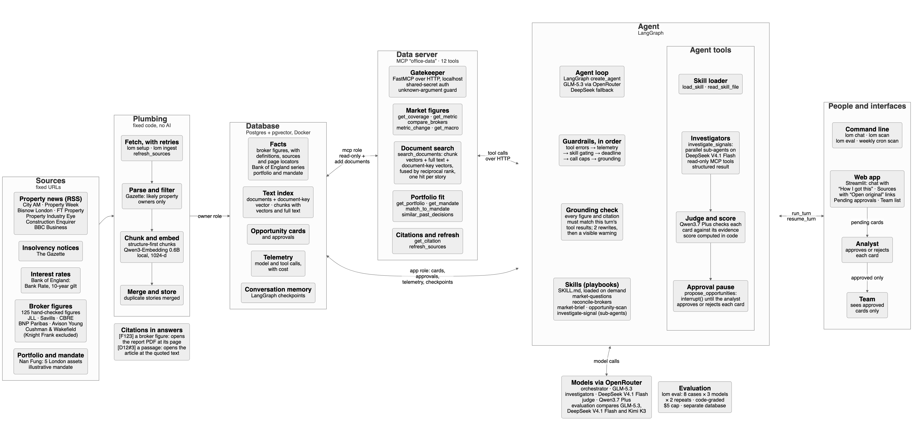

# London Office Monitor

An AI agent for a buy-side investment analyst who covers the London office market. It does two jobs:

1. **Saves time on routine work.** It answers market questions with every broker's figure and its source, charts how figures and rates have moved, explains why brokers disagree, finds what Nan Fung decided before, and writes the weekly brief.
2. **Spots opportunities.** A scan reads the week's news and insolvency notices against Nan Fung's portfolio and mandate. Sub-agents investigate each lead in parallel, and the results become opportunity cards. The analyst approves or rejects each card, and only approved cards reach the team, under **Opportunities › Approved** in the web app.

Every figure and passage in an answer carries a citation, such as `[F57]` for a broker figure or `[D188#0]` for a news passage, that opens the original source. Before an answer is shown, code checks each figure against the data it came from.

This is a proof of concept. It runs on your machine against a snapshot of real news, taken on 24 Oct 2026, plus 125 hand-checked broker figures and six mock internal documents.



## 10-minute setup

You need [Docker](https://docs.docker.com/get-docker/) and [uv](https://docs.astral.sh/uv/getting-started/installation/).

1. `cp .env.example .env`, then put the OpenRouter key provided with the submission, or your own, in `OPENROUTER_API_KEY`.
2. `docker compose up -d db` starts Postgres with pgvector on `127.0.0.1:55433`.
3. `uv sync` installs Python 3.12 and the dependencies.
4. `uv run lom setup` creates the database and loads the broker figures, the news snapshot and the mock internal documents. The first run downloads the embedding model, about 1.1 GB.
5. `uv run lom ui`, then open http://127.0.0.1:8501.

Prefer the terminal? Use `uv run lom chat` to ask questions, and `uv run lom scan` to run the opportunity scan. What a scan finds then waits under **Opportunities › To review** in the web app.

## Demo questions

An empty chat offers example questions like these as buttons.

- What's City prime rent now, and do the brokers agree?
- Why do BNP Paribas and Savills report different City prime rents?
- How has City prime rent moved? (The answer comes with a chart.)
- What are Bank Rate and the 10-year gilt yield doing? (Also charted.)
- What did we decide on Example House before, and why? (Answered from a mock investment-committee note.)
- Write this week's London office brief. (This is also a button in the sidebar while you're on Chat.)
- Anything worth a look this week? (This runs the opportunity scan and takes about 4 minutes. You can also start a scan with **Run a new scan** under **Opportunities**, which keeps the chat free while it works.)
- What does the supply pipeline mean for 99 City Road?
- 西區的空置率是多少？ (The agent answers in the language you ask in.)

Under each answer, **Sources** lists every cited figure or passage with an "Open original" link. **How I got this** lists the skills loaded, each tool call, the grounding check, and each model call with its tokens and cost.

## How it works

- **Data server (MCP).** The agent reaches all data through its own MCP server, `office-data`, which serves 13 tools over HTTP on localhost behind a shared secret. Tool arguments are validated, and unknown arguments are refused. A licensed data source could later plug in as another MCP server.
- **Store.** Postgres with pgvector. Numbers live in tables:
  - broker figures, each with its definition, source and page
  - Bank of England series
  - the portfolio and the mandate

  Words live in vectors: news, insolvency notices and Nan Fung's internal documents. A document's title and summary form its key, and its body is split into chunks along its structure. Search ranks chunks and keys, each by vector and by full text, and returns one hit per story. A hit also carries the nearby passages of its document, each with its own citation, so a question that matches an investment-committee note's proposal still sees its decision and reasons.
- **Internal documents.** Policies, investment-committee notes, checklists and debriefs are Markdown files with front matter in `data/internal/`, loaded by `lom setup`. The six bundled ones are mock examples, titled `[MOCK]`. The chat cites them, and scan investigators check them before proposing a card, for example a past decision's "revisit if" condition.
- **Charts.** `metric_trend` returns each broker's series with the change between periods computed in code. The app draws charts only from this turn's trend and rate results, never from the model's text, and puts the data in a table under each chart.
- **Agent loop.** LangChain `create_agent` on LangGraph. Its middleware, in order:
  - turns tool errors into messages
  - records telemetry
  - gates tools by skill
  - clears earlier turns' data results from what the model is sent; the stored conversation keeps them
  - enforces a deadline and call caps
  - runs the grounding check, which allows two rewrites, then attaches a visible warning
- **Skills.** `SKILL.md` playbooks, loaded on demand. Loading a skill unlocks its tools.

| Skill | What it does |
|---|---|
| `market-questions` | Answers a figure or trend question with every broker's exact, cited figure, and questions about Nan Fung's own policies and past decisions |
| `reconcile-brokers` | Explains why brokers report different figures, and gives a house-view range |
| `market-brief` | Writes the weekly brief: what changed, news themes, rates, what it means for the portfolio, and what's coming up |
| `opportunity-scan` | Finds candidate signals from the last 14 days, investigates them and proposes cards |
| `investigate-signal` | Instructions for the investigator sub-agents |

- **Opportunity scan.**
  - The orchestrator picks up to 5 candidates.
  - `investigate_signals` runs one investigator sub-agent per candidate, in parallel. Each returns a card or a discard with its reason.
  - A judge model checks each card against its evidence.
  - A story already put to the analyst, waiting or decided, is skipped by later scans without an investigation, so a new scan never queues the same story twice. To rerun the demo scan from scratch, use `uv run lom setup --reset`.
  - Each card is written for readers who are not property-finance specialists. It opens with what it is to Nan Fung (a chance to buy, a chance to lease, a risk to our buildings, or one worth watching), then says what happened, what it means for us and what to do next, as numbered steps. Its sources and score sit in a fold below.
  - Code computes the score out of 100 from four parts: fit to the mandate (up to 40), signal type (25), recency (20) and confidence (15). Each card shows every part against its maximum, with the input it came from, such as the closest portfolio asset and the age of the newest evidence.
  - `propose_opportunities` pauses the run with LangGraph's `interrupt()`.
  - The analyst decides each card on its own, with an optional reason. Each decision is saved at once, and an approved card appears under **Approved** immediately.
  - After the last card, the run resumes and writes its report. It can resume from another process, because the checkpoints live in Postgres.
  - Each card keeps its first decision, and the analyst's reasons inform later scans.
  - Only one request runs on a conversation at a time; a database lock refuses a second one, for example from another browser tab.
- **Scope.** A request outside the London office market and Nan Fung's own records gets a one-line "Outside my scope:" reply. Without a playbook the agent has no data tools, and the grounding check blocks figures from memory.
- **Telemetry.** Every model and tool call is stored with its cost and latency.

## Which model for which job

All models run through OpenRouter: GLM-5.3 orchestrates, DeepSeek V4.1 Flash investigates and Qwen3.7 Plus judges. Each candidate model was run in one role at a time. The orchestrator role was tested on 6 chat cases and the investigator role on 2 scans. Results from 24 Oct 2026; the reports are in `evals/results/`.

| Role | Model | Passed | Mean cost per case | Typical time |
|---|---|---|---|---|
| Orchestrator | **GLM-5.3** (default) | 5/6, then 6/6 | $0.015 | 12 s |
| Orchestrator | DeepSeek V4.1 Flash | 5/6, then 6/6 | $0.004 | 11 s |
| Orchestrator | Kimi K3 | 5/6, then 6/6 | $0.030 | 13 s |
| Investigator | **DeepSeek V4.1 Flash** (default) | 2/2 | $0.055 | 80 s |
| Investigator | GLM-5.3 | 2/2 | $0.131 | 131 s |
| Investigator | Kimi K3 | 1/2 | $0.154 | 81 s |

- In the first run, all three orchestrators failed the same case: asked to average the brokers, they rightly refused, but listed only the brokers that had published for the latest quarter. That was a gap in our own playbooks, `market-questions` and `reconcile-brokers`. After the fix, the case was re-run and passed for every model. The "then 6/6" column shows that re-run.
- As investigator, Kimi K3 missed the planted insolvency lead.
- DeepSeek matched GLM-5.3 as orchestrator on the chat cases at about a quarter of the cost; repeat runs should confirm that before it becomes the default.

A second run on 25 Oct 2026 added three chat cases and a **Routing** column. The playbook the agent loads is its intent label, so routing counts runs that loaded the expected playbook and no unwanted one. The new cases are a past decision that must be answered from internal documents, a trend that must be charted, and an off-topic request that must be declined.

| Orchestrator | Passed | Routing | Mean cost per case |
|---|---|---|---|
| **GLM-5.3** (default) | 8/9 | 8/8 | $0.011 |
| DeepSeek V4.1 Flash | 9/9 | 8/8 | $0.002 |
| Kimi K3 | 8/9 | 8/8 | $0.029 |

- Every model loaded the right playbook on every case that checks it, and passed all three new cases.
- GLM-5.3 again left out a broker in the "average them" case, and Kimi K3 explained the vacancy spread without calling `compare_brokers`.
- Evaluation spend so far, across every run on both days: $1.47.

This is directional: 11 cases, one run each, graded by code rather than by another model. Run it yourself with:

```
uv run lom eval --models openrouter:z-ai/glm-5.3,openrouter:deepseek/deepseek-v4.1-flash,openrouter:moonshotai/kimi-k3
```

It recreates a separate `lom_eval` database and stops before a $5 spending cap (`LOM_EVAL_BUDGET_USD`).

## Decisions and limits

- **Demo mode** is the default. The clock is pinned to 24 Oct 2026 and the agent uses the stored snapshot, so every reviewer sees the same results. Six synthetic items stand in for events the real snapshot lacks: an insolvency, an AI letting, a supply gap, two off-mandate decoys and a prompt injection. They are labelled `[SYNTHETIC]` everywhere, including on any card built on them.
- **Knight Frank is excluded** from the broker figures, because its reports prohibit AI use of their data. News items that quote Knight Frank are cited to the publisher that reported them.
- **Licences.** Broker figures are headline numbers cited with attribution and a link. No broker PDF is stored or sent to a model. Savills' report says it may not be quoted without consent, and BNP Paribas' says it may not be reproduced, so both need legal sign-off before any wider use. News is stored only as each feed publishes it: title, summary, link and date.
- **Security.** The web app and the data server bind to localhost, and there is no login; that is a stated gap for a proof of concept. Secrets come from `.env` and are redacted from logs and errors. The database has three roles: the owner for setup, the app, and a read-mostly data server. Publisher text is treated as data, never as instructions, and a test injection checks this.
- **Model access from Hong Kong.** The default models are served to Hong Kong through OpenRouter; Anthropic and the OpenAI API are not. Requests ask providers not to retain or train on prompts (`LOM_PROVIDER_DATA_COLLECTION=deny`).
- **The mandate is illustrative.** Nan Fung's real criteria are not public, so `data/seed/mandate.yaml` stands in until the team supplies its own.
- **Internal documents are mock.** Real ones need an access and data-residency review before loading: the passages retrieved for a question are sent to the model provider.
- **Long conversations.** Every model call resends the conversation. Earlier turns' data results are cleared from it, since every figure must come from this turn's results, but questions and answers still add up and nothing summarises them, so a very long conversation can still outgrow the model's context window.
- **Trends are short.** Of the 106 stored broker series, 87 hold one quarter and 19 hold two (mostly JLL and Savills), so charts show direction, not history. Backfilling about eight quarters is the obvious next step.

## Live mode

Set `LOM_LIVE=true` in `.env` to use the real clock and pull live news feeds, Gazette notices and Bank of England series. Run `uv run lom ingest` to fetch on demand. Feeds list only their newest items, so `lom ingest` pages back through each feed until it reaches items over 3 days old, up to 5 pages, and says when it falls short. The agent also refreshes before a turn when the newest stored item is over an hour old, taking each feed's first page only. `ops/cron.example` runs `lom ingest` every day at 06:00, so nothing drops off between uses, and the scan every Monday at 07:00; what the scan finds waits under Opportunities › To review.

**Real data only.** Live mode on the demo database still sees the six made-up demo items, and live items dated before 24 Oct would show up in the demo. To look for real opportunities, use a second database that leaves the demo items out, with its own data server port:

```bash
LOM_DB_NAME=lom_live uv run lom setup --no-demo-items
LOM_LIVE=true LOM_DB_NAME=lom_live uv run lom ingest
LOM_LIVE=true LOM_DB_NAME=lom_live LOM_MCP_PORT=8767 uv run lom ui --port 8502
```

Port 8765 serves the demo database's data server and 8766 the evals'. The demo database and the evals are unaffected. A week of real news may hold nothing that fits the mandate, and the scan then says so.

## Troubleshooting

- **"Cannot connect to the database at 127.0.0.1:55433"**: Docker isn't running, or the database isn't started. Run `docker compose up -d db`.
- **Port 55433 is busy**: set another port as `LOM_DB_PORT` in `.env` (Docker Compose reads it too), then run `docker compose up -d db` again.
- **"Model access failed: the OpenRouter key is missing, invalid or out of credit"**: check `OPENROUTER_API_KEY` and the key's credit at https://openrouter.ai/settings/keys.
- **"The data server is not reachable"**: restart `uv run lom ui`, which starts the data server, or run `uv run lom mcp` in another terminal.

## Development

The slides are in `slides/`, as `.pptx` and PDF. `slides/source/` holds the pptxgenjs script that builds them, and screenshots of the web app are in `docs/screenshots/`. `uv run pytest` runs the test suite against a separate `lom_test` database; `uv run pytest -m live` adds two live OpenRouter checks, which cost under a cent. The design is in `docs/superpowers/specs/`, the build plan in `docs/superpowers/plans/`, and the background research in `docs/research/`.
